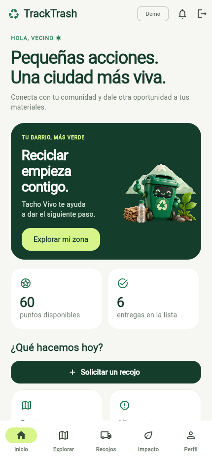

# TrackTrash Mobile · 0.2

Flutter para conectar vecinos y recicladores de Arequipa. [Backend C# separado](https://github.com/CarlosFloresDev/tracktrash-backend). Interfaz en español con identidad Tacho Vivo, ilustración original, iconos nativos, navegación adaptable y animaciones que respetan movimiento reducido.



## Recorridos disponibles

- Inicio con accesos rápidos, guía de materiales y seguimiento de recojos.
- Mapa/lista con contenedores, aliados y puntos de acopio, filtros, origen y antigüedad; GPS opcional y reportes de nivel.
- Recojos con asignación cercana, aceptación, viaje, código privado, cancelación e historial.
- Puntos, rachas, beneficios con stock/canje y movimientos propios. Cantidades estimadas, sin atribuir CO2.
- Perfil, incidencias, bandeja de avisos, horarios y recordatorios por suscripción.
- Avisos internos configurables por categoría, pausa global sin perder la selección y antelación editable por ruta (5–60 minutos, 20 por defecto). Cambiar una ruta suscrita requiere guardar la nueva anticipación.
- Acceso demo vecino/reciclador/operador y panel operativo adaptable a web.
- Integración de registro/login Supabase, renovación y almacenamiento seguro; falta probar credenciales y configuración del proyecto real.

Las pantallas consumen API y PostgreSQL reales. Datos de aliados, ubicaciones, horarios y beneficios de demostración están identificados; no representan convenios ni GPS de camiones. [Cobertura completa RF/RNF y pendientes](https://github.com/CarlosFloresDev/tracktrash-backend/blob/feat/ecosistema-tracktrash/docs/MATRIZ_COBERTURA.md).

## Ejecutar

Flutter 3.41.6 / Dart 3.11.4 fijados en `.fvmrc`; conservar lockfile y no actualizar el SDK global por este proyecto. Iniciar backend/BD según su README.

```powershell
flutter pub get --enforce-lockfile
flutter run -d edge --web-port=5300 --dart-define=DEMO_MODE=true --dart-define=API_BASE_URL=http://localhost:5080
```

Android Emulator: API_BASE_URL `http://10.0.2.2:5080`. Teléfono físico: IP LAN del servidor con acceso local habilitado deliberadamente. HTTP solo en debug; producción requiere HTTPS. El modo demo se desactiva por defecto en release y también debe estar desactivado en el servidor.

Para Supabase configurar los tres valores de cliente:

```powershell
flutter run -d edge --web-port=5300 --dart-define=DEMO_MODE=false --dart-define=API_BASE_URL=https://<api> --dart-define=SUPABASE_URL=https://<referencia>.supabase.co --dart-define=SUPABASE_PUBLISHABLE_KEY=<clave-publicable>
```

Nunca usar conexión SQL ni service_role en Flutter. Rol efectivo lo devuelve la API. Sesiones Auth en FlutterSecureStorage, demostración en memoria. La recuperación actual solicita el correo; falta completar/configurar retorno y cambio de contraseña, SMTP y pruebas remotas.

## Mapa y conexión

Se consulta el mapa cada 30 segundos en primer plano. SharedPreferences guarda solo el último mapa público, con advertencia de antigüedad al recuperar la caché. No guarda direcciones privadas, códigos, perfiles ni tokens. No hay cola offline para escrituras; confirmaciones/canjes necesitan servidor.

Mapa base OpenStreetMap con atribución y proveedor configurable mediante `MAP_TILE_URL`. Sus mosaicos necesitan conexión y tienen [política de uso](https://operations.osmfoundation.org/policies/tiles/); seleccionar proveedor/contrato apropiado antes de un piloto público. Caché de puntos no equivale a mapas base descargados. [Guía oficial flutter_map](https://docs.fleaflet.dev/tile-servers/using-openstreetmap-direct).

## Validación y compilación

[Piloto web](https://tracktrash.pages.dev), con Supabase real y datos ficticios. [Firma y distribución](docs/DISTRIBUCION_PILOTO.md). La rama actual es `feat/ecosistema-tracktrash`; main conserva el primer incremento. Los comandos locales de abajo corresponden a desarrollo.

```powershell
dart format --output=none --set-exit-if-changed lib test
flutter analyze
flutter test
flutter build web --dart-define=DEMO_MODE=true --dart-define=API_BASE_URL=http://localhost:5080
flutter build apk --debug --dart-define=DEMO_MODE=true --dart-define=API_BASE_URL=http://10.0.2.2:5080
```

24 pruebas aprobadas: formulario, red/identidad, reintentos, doble envío, ciclo del ViewModel, caché pública y su falla/recuperación, almacenamiento seguro, serialización y preferencias/antelación. Web y APK debug compilados; APK en `build/app/outputs/flutter-apk/app-debug.apk`, ignorado por Git. Apunta a Android Emulator; recompilar con IP LAN para teléfono físico. Falta instalar/probar en Android e iOS; iOS requiere macOS/Xcode y no se compiló en Windows.

`tools/smoke_web.py` ofrece un recorrido real con Playwright/Edge contra API demo y web local. Crea datos de prueba sin borrar recojos existentes. Dependencia opcional de QA: Python + paquete playwright. Capturas en [docs/screenshots](docs/screenshots).

`tools/smoke_preferences_web.py` comprueba guardado de preferencias y anticipación desde la UI; restaura el perfil y la suscripción originales. Admite `TRACKTRASH_WEB_URL`/`TRACKTRASH_API_URL` si los puertos habituales están ocupados. [Evidencia de este incremento](docs/VALIDACION_AVISOS.md). Aplicar migración y desplegar la API nuevas antes de este cliente; la API anterior no aplica las nuevas opciones.

Iconos reproducibles: `dart run flutter_launcher_icons`. [Procedencia y prompt de la ilustración](assets/README.md). Imágenes generadas con herramienta imagegen y usadas como recurso local, sin llamadas a IA en la app.

## Estructura

`app` compone tema/router/dependencias; `core` configura red/errores/seguridad. `features/session` integra acceso; `pickups` y `community` separan modelos, repositorios y presentación con Riverpod/ViewModels. Pantallas sin Dio directo; permisos, saldos y reglas definitivos en C#.

CI verifica formato, análisis, pruebas y compilación web. Commits por cambio coherente y ramas `feat/<tarea>`; consultar AGENTS.md para continuar. Faltan fotos/Storage, push real, depósitos validados, instituciones, camiones/ETA y validación operativa; no se presentan como completados.
