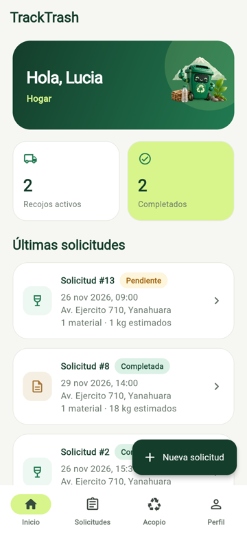
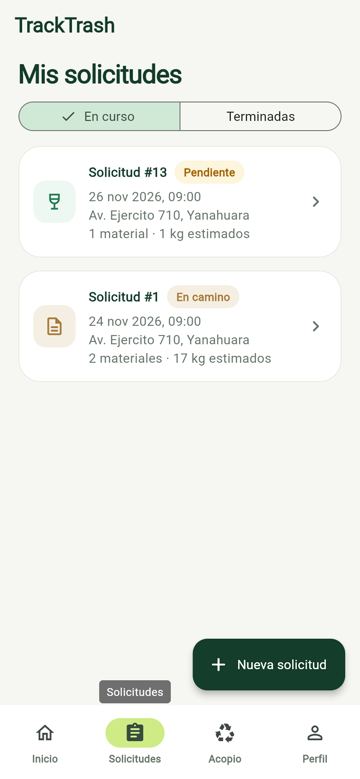
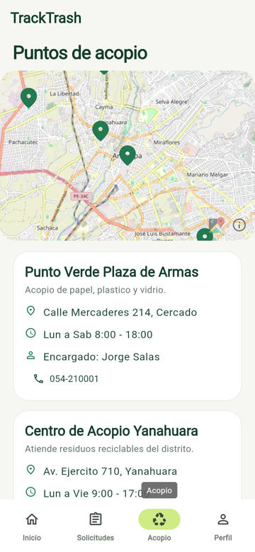
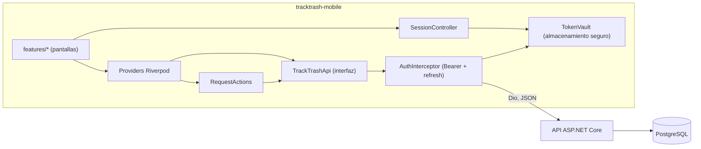

<p align="center">
  
</p>

<p align="center">
  
  
  
  
  
</p>

<p align="center">
  <a href="#funcionalidades">Funcionalidades</a> ·
  <a href="#capturas">Capturas</a> ·
  <a href="#arquitectura">Arquitectura</a> ·
  <a href="#ejecutar">Ejecutar</a>
</p>

## Sobre el proyecto

**TrackTrash** coordina el recojo de residuos reciclables en Arequipa entre hogares, organizaciones y recolectores
verificados. Esta es la app móvil, pensada para el uso en la calle: pedir un recojo desde casa o postularse a él y registrar los
kilos recuperados como recolector. Comparte el contrato con la [plataforma web](https://github.com/CarlosFloresDev/tracktrash-web).

| Repositorio | Tecnología |
| --- | --- |
| Mobile (este repositorio) | Flutter, Riverpod, go_router, Dio |
| [Web](https://github.com/CarlosFloresDev/tracktrash-web) | React, TypeScript, Tailwind CSS |
| [Backend](https://github.com/Luladusilva/TrackTrash) | ASP.NET Core 10, CQRS con MediatR, PostgreSQL |

## Funcionalidades

| Rol | Recorridos |
| --- | --- |
| Hogar y organización | Crear solicitudes (materiales, dirección con GPS opcional, fecha y hora), ver recolectores compatibles, aceptar o rechazar postulaciones, seguir el estado, cancelar y calificar |
| Recolector | Elegir los materiales que acepta, ver recojos compatibles y postularse, seguir sus postulaciones, iniciar, registrar material recuperado, finalizar o soltar; kilos y calificación propios |
| Administrador | Indicadores generales (la gestión completa está en la web) |
| Todos | Inicio de sesión con JWT y sesión persistente, mapa de puntos de acopio, perfil y edición de datos |

Experiencia: banner animado, mascota flotante, entrada escalonada de tarjetas, tirar para actualizar, estados de carga,
vacío y error, y respeto a la opción "reducir movimiento" del sistema.

## Capturas

<p align="center">
  
  
  
  
</p>

## Arquitectura



```
lib/
  core/      configuración y ApiFailure (errores del backend en español)
  data/      enums, modelos, TrackTrashApi + DioTrackTrashApi, tokens e interceptor de autenticación
  features/  session, requests, gatherer, home, points, profile
  app/       providers, router y navegación por rol
  ui/        tema, animaciones y widgets compartidos
test/        modelos, errores de API, sesión JWT y flujo de acceso; e2e/ contra una API real
```

* Las pantallas no usan Dio directamente: dependen de `TrackTrashApi`, que en pruebas se reemplaza por un fake.
* **Sesión JWT:** el login guarda el par de tokens cifrado (`flutter_secure_storage`). `AuthInterceptor` agrega el
  `Bearer`, renueva el token antes de que venza o tras un `401 ACCESS_TOKEN_EXPIRED` (una sola renovación compartida,
  porque el refresh token rota) y, si el servidor rechaza la sesión, la app vuelve al ingreso con un aviso.
* **Permisos por rol:** cada pantalla solo consulta endpoints permitidos para su rol; por ejemplo, el recolector calcula
  sus kilos y su calificación desde sus propios servicios y no desde los indicadores de administración.
* Las transiciones de estado replican las reglas del backend para ofrecer solo acciones válidas.

## Ejecutar

Flutter 3.41.6 (ver `.fvmrc`). Con la API corriendo (instrucciones en el repositorio web, carpeta `local-dev`):

```powershell
flutter pub get
flutter run --dart-define=API_BASE_URL=http://localhost:5145
```

| Entorno | `API_BASE_URL` |
| --- | --- |
| Navegador o escritorio | `http://localhost:5145` |
| Emulador Android | `http://10.0.2.2:5145` |
| Teléfono físico | `http://<IP-de-tu-PC>:5145` |
| Producción | `https://<api-en-render>` |

```powershell
flutter analyze
flutter test
# Flujo completo contra una API real (registro, postulación, recojo, calificación, refresh y logout):
flutter test test/e2e --dart-define=E2E_API=http://localhost:5145 `
  --dart-define=E2E_ADMIN=admin@tracktrash.pe --dart-define=E2E_ADMIN_PASSWORD=TrackTrash2026!
flutter build apk --release --dart-define=API_BASE_URL=https://<api-en-render>
```

Cuentas de ejemplo (contraseña `TrackTrash2026!`): `lucia@correo.pe` (hogar), `elmer@recicla.pe` (recolector),
`admin@tracktrash.pe` (administrador).

---

<p align="center">Proyecto académico de Tecsup Arequipa, 2026.</p>
