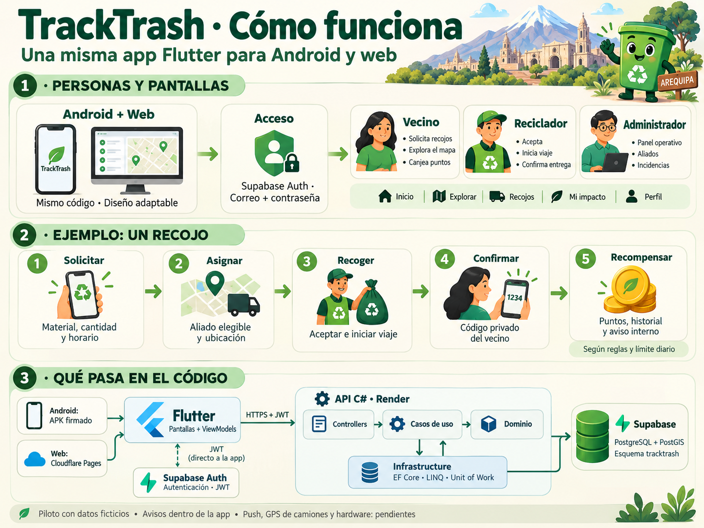

# TrackTrash: flujo y mapa del código

Guía para explicar el piloto a los compañeros. Código actual en `feat/ecosistema-tracktrash`; los PR #2 siguen abiertos y main conserva el primer incremento. La imagen es una infografía explicativa; sus pantallas son ilustrativas.

## Para explicarlo en una exposición

> TrackTrash conecta a vecinos con recicladores. El vecino solicita un recojo; un reciclador de una asociación elegible lo acepta y registra el avance. Al entregar, el vecino comparte su código privado; el reciclador lo introduce y el servidor valida la confirmación, actualiza el historial y otorga los puntos correspondientes. Android y web utilizan el mismo proyecto Flutter. Supabase gestiona las identidades y la base de datos; nuestra API C# ejecuta las reglas y permisos.

## ¿Android y web son iguales?

Comparten pantallas, modelos, repositorios y lógica Dart. Se compilan como APK o como web. `WorkspaceScreen` muestra navegación inferior en tamaños pequeños y una barra lateral desde 1000 píxeles de ancho. Ubicación, almacenamiento de sesión y enlaces de correo pueden comportarse distinto entre plataformas; compartir código no sustituye sus pruebas.

## Dónde está cada parte de Flutter

Las rutas parten del repositorio `tracktrash-mobile`.

| Parte | Archivo o carpeta | Responsabilidad |
|---|---|---|
| Arranque | [lib/main.dart](../lib/main.dart) | Inicializa Flutter/Supabase y carga la app. |
| Navegación | [tracktrash_app.dart](../lib/app/tracktrash_app.dart) | Rutas go_router, tema, idioma y acceso según sesión/rol. |
| Dependencias | [providers.dart](../lib/app/providers.dart) | Riverpod crea Dio, sesión, repositorio y ViewModel de recojos. |
| Acceso | [features/session](../lib/features/session) | Bienvenida, formularios, registro/login y sesión segura. `session.dart` consulta el rol efectivo al servidor. |
| Cinco áreas principales | [workspace_screen.dart](../lib/features/community/presentation/workspace_screen.dart) | Inicio, Explorar, Recojos, Mi impacto y Perfil; adapta la navegación al ancho. |
| Pantallas funcionales | [community/presentation](../lib/features/community/presentation) | Mapa, horarios, incidencias, avisos, impacto y panel operativo. |
| Formulario de recojo | [create_pickup_screen.dart](../lib/features/pickups/presentation/create_pickup_screen.dart) | Recoge material, cantidad, dirección, horario y ubicación opcional. |
| Estado del recojo | [pickups_view_model.dart](../lib/features/pickups/presentation/pickups_view_model.dart) | Coordina operaciones, carga, errores y bloqueo de doble envío. |
| HTTP de recojos | [pickup_repository.dart](../lib/features/pickups/data/pickup_repository.dart) | Envía solicitudes con Dio/JWT y convierte JSON en modelos. |
| HTTP de comunidad | [community_repository.dart](../lib/features/community/data/community_repository.dart) | Perfil, mapa, horarios, avisos, incidencias y recompensas. |
| Configuración pública | [pilot.public.json](../config/pilot.public.json) | Servidores del piloto, clave publicable y modo demo desactivado. No contiene claves administrativas. |
| Diseño | [eco_design.dart](../lib/ui/eco_design.dart) y [assets](../assets) | Tema, componentes, animaciones e ilustración Tacho Vivo. |

## Las cuatro capas del backend C#

Repositorio independiente: [tracktrash-backend, rama actual](https://github.com/CarlosFloresDev/tracktrash-backend/tree/feat/ecosistema-tracktrash). Las rutas siguientes parten de su raíz.

| Capa | Carpeta | Responsabilidad |
|---|---|---|
| Api | `src/TrackTrash.Api` | Program y controllers: reciben HTTP, aplican restricciones y llaman casos de uso. |
| Application | `src/TrackTrash.Application` | DTOs, interfaces de servicios y casos de uso concretos con ExecuteAsync. Coordinan cada operación. |
| Domain | `src/TrackTrash.Domain` | Entidades, reglas e interfaces de repositorios/Unit of Work. No depende de EF ni ASP.NET. |
| Infrastructure | `src/TrackTrash.Infrastructure` | EF Core, consultas LINQ, repositorios, Unit of Work, JWT, middleware, worker e inyección de dependencias. |

La flecha de la imagen representa el recorrido de una petición. Las dependencias de proyectos son distintas: Application conoce Domain; Infrastructure implementa contratos de Domain/Application; Api compone el conjunto. Domain no conoce SQL ni el framework web.

## Sigue un recojo de principio a fin

1. `create_pickup_screen.dart`, método `_submit()`, construye un `PickupDraft` y llama a `PickupsViewModel.create()`.
2. `ApiPickupRepository.create()` envía `POST /api/v1/solicitudes`, con JSON y token JWT. Flutter no se conecta por SQL a las tablas de negocio.
3. En C#, `src/TrackTrash.Api/Controllers/SolicitudesRecojoController.cs` recibe la petición. La creación exige rol vecino y llama a `CrearSolicitudRecojoUseCase`.
4. `src/TrackTrash.Application/UseCases/SolicitudesRecojo/CrearSolicitudRecojoUseCase.cs` verifica usuario y clave de idempotencia, crea la solicitud y agrega historial. Si se pidió asignación automática, busca un aliado elegible por ubicación, material y capacidad; puede rechazarla si no hay candidato.
5. `src/TrackTrash.Domain/Entities/SolicitudRecojo.cs` valida reglas y estados. En Infrastructure, `Persistence/Repositories` implementa las consultas; `TrackTrashDbContext.cs` configura EF y `UnitOfWork.cs` guarda los cambios en PostgreSQL, esquema `tracktrash`.
6. La API devuelve JSON; Flutter lo convierte en un modelo y el ViewModel actualiza la pantalla. La clave estable de cada intención permite evitar duplicados.
7. `AceptarSolicitudRecojoUseCase.cs` exige un reciclador vinculado a una asociación elegible, reserva capacidad y notifica al vecino. `IniciarViajeUseCase.cs` registra el avance; no representa GPS en vivo.
8. El vecino comparte su código privado real de **seis dígitos** al entregar. `UseCases/Entregas/ConfirmarEntregaUseCase.cs` comprueba actor y código, libera capacidad, actualiza racha e historial y agrega el aviso interno. `Domain/Entities/PoliticaRecompensas.cs` define **20 puntos por entrega**, con tope de **200 puntos positivos al día**. Repetir una confirmación no vuelve a premiar.

Los puntos, stock, permisos y estados definitivos los decide el servidor. Ocultar botones en Flutter mejora la experiencia; la autorización también se aplica en la API.

## Acceso y roles

Supabase Auth registra/confirma usuarios y entrega JWT al cliente. `Infrastructure/Configuration/DependencyInjection.cs` configura la validación y obtiene el rol protegido desde `app_metadata.tracktrash_role`. El registro público crea vecinos; editar el perfil no otorga privilegios. Las cuentas de reciclador requieren rol y asociación; las administrativas se habilitan técnicamente. Falta una pantalla para solicitar/aprobar/gestionar esos roles. Las contraseñas del piloto no están en los repositorios.

La confirmación de correo vuelve a `https://tracktrash.pages.dev`; la configuración remota está en `deployment/auth` del backend. Después se puede volver a la APK e iniciar sesión. El retorno directo por enlace profundo a Android sigue pendiente.

## Dónde se ejecuta

| Pieza | Alojamiento |
|---|---|
| Flutter Android | APK firmado instalado en cada teléfono. |
| Flutter web | Cloudflare Pages: https://tracktrash.pages.dev |
| API ASP.NET Core | Render Free: https://tracktrash-api.onrender.com |
| Identidades y datos | Supabase Auth y PostgreSQL/PostGIS. |
| Descargas APK | Bucket público dedicado de Supabase Storage; no es almacenamiento de fotos ciudadanas. |

El piloto publicado no depende de Docker ni de una API en la PC. Docker se usa para desarrollar y probar localmente. Render Free puede dormir; los avisos internos programados no tienen puntualidad garantizada mientras duerme.

## Alcance real de la imagen

Los aliados, rutas y ubicaciones precargadas son ficticios. No hay seguimiento GPS de camiones ni push FCM/APNs. Hardware físico, fotos privadas, recuperación completa, instituciones, carga, restauración e instalación/validación física de Android siguen pendientes según la matriz de cobertura.

Infografía original generada con `image_gen` mediante la skill imagegen, sin imágenes de entrada, y revisada contra el código. Sus ilustraciones no sustituyen capturas de QA ni los contratos HTTP. La guía conserva la explicación editable para futuras versiones.
