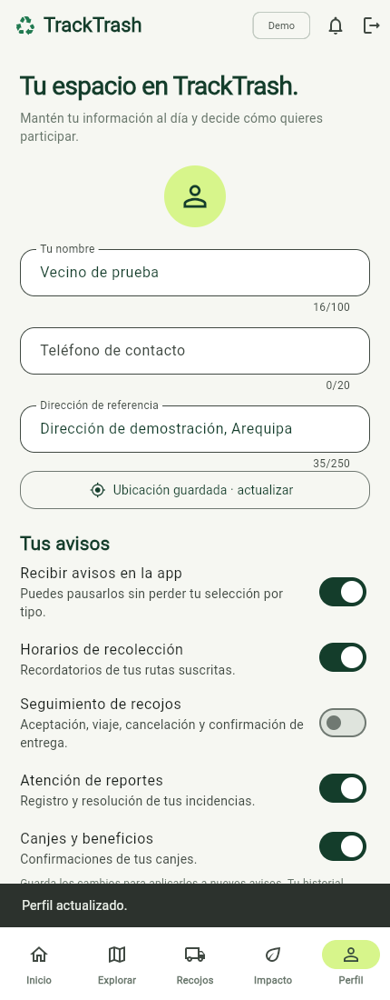
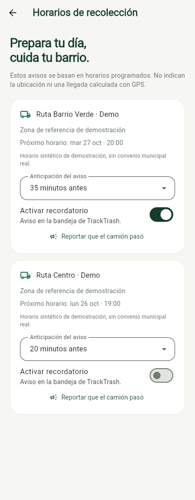

# Incremento de avisos y anticipación

Continuación del 24/10/2026 sobre el incremento 0.2, manteniendo ambos repositorios y los PR #2 abiertos.

Antes, solo se podía pausar el recordatorio de horarios y Flutter enviaba siempre 20 minutos. El servidor ignoraba cambios de minutos en una suscripción existente. Ahora el vecino puede elegir categorías de avisos internos y guardar otra anticipación por ruta.

- Pausa global que conserva la selección individual de horarios, recojos, incidencias y canjes.
- Selección aplicada en servidor antes de registrar nuevos avisos, sin borrar historial ni impedir confirmar entregas, sumar puntos, canjear o reportar.
- Anticipación editable de 5–60 minutos; cambio de una ruta ya suscrita requiere guardar. Repetir el mismo valor no duplica ni reprograma otra vez.
- Migración aditiva que conserva avisos previos y su estado de lectura; clientes anteriores que omiten preferencias no las reinician.

## Verificación

47 pruebas backend aprobadas contra PostgreSQL/PostGIS y compilación Release sin advertencias. 24 pruebas Flutter aprobadas, flutter analyze sin incidencias, compilaciones web y APK debug completadas. Pruebas nuevas cubren aislamiento, pausa/selección, operaciones con avisos silenciados, worker, migración con datos previos y actualización idempotente de suscripciones; widgets verifican controles y envío al guardar.

`tools/smoke_preferences_web.py` se ejecutó en Edge headless contra API/PostgreSQL reales: desactivar avisos de recojos en Perfil, guardar y comprobar API; elegir 35 minutos en Horarios, activar/guardar y comprobar API. Sin errores JavaScript. El script restableció el perfil y la suscripción originales incluso en las iteraciones de ajuste de selectores.

La sesión de Flutter existente en 5300 se conservó. Para QA se sirvió build/web en 5301 y se habilitó ese origen solo en el proceso API de desarrollo. Para repetir con esos puertos:

```powershell
$env:TRACKTRASH_WEB_URL='http://localhost:5301'
python tools/smoke_preferences_web.py
```

El host API debe estar activo y permitir ese origen. Sin variables se usan los puertos 5300 y 5080 de los README. Estas pruebas requieren datos demo y no deben ejecutarse contra producción.





No se validan Supabase remoto, entrega push, GPS/ETA, instalación Android/iOS ni hardware. RF-04 y RF-14 conservan su estado parcial por esos alcances aún pendientes; ver la matriz del backend.
